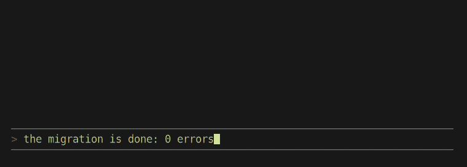
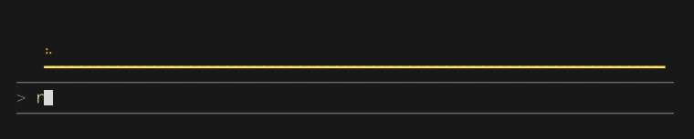
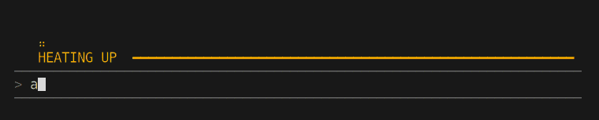
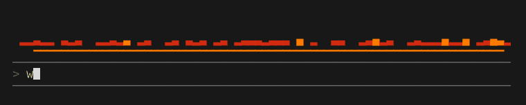
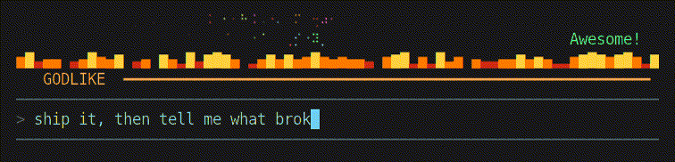
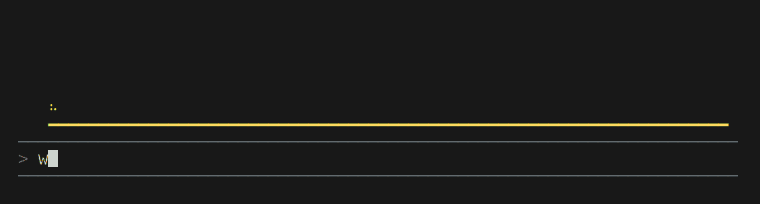
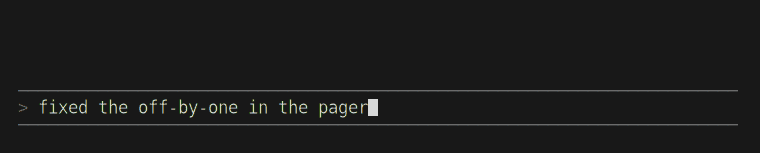
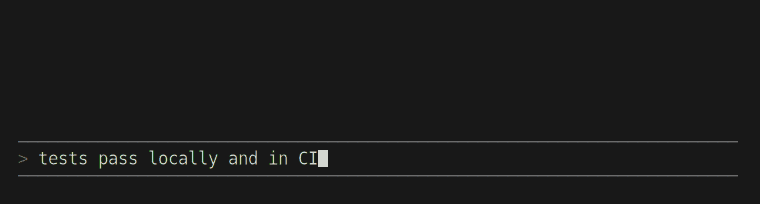
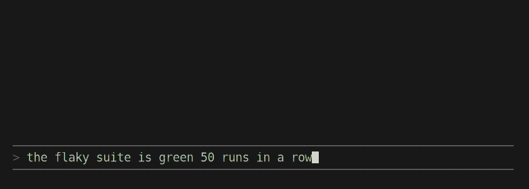
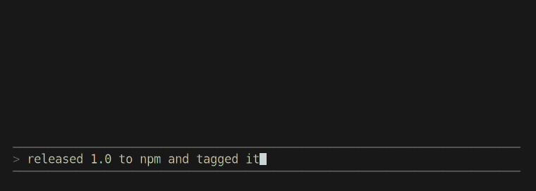

# Power Mode for Claude Code

Sparks fly off the caret as you type into the Claude Code prompt. Keep typing and
the combo builds, the effects grow with it, and a paste goes off like a bomb. When
Claude lands something big, it can set off fireworks or, once a project, a mushroom cloud. It is a Claude Code mod in the spirit of the editor classics:
[activate-power-mode](https://github.com/JoelBesada/activate-power-mode) for Atom and
[vscode-power-mode](https://github.com/hoovercj/vscode-power-mode).



## Install

At the prompt of a Claude Code terminal session:

```
/plugin install power-mode --marketplace maxmillienjr/claude-code-power-mode
```

Answer `y` to add the marketplace, then pick a scope (user is the usual one).

From a shell:

```
claude plugin install power-mode --marketplace maxmillienjr/claude-code-power-mode
```

In the desktop app: click + next to the prompt box, then Plugins, Add marketplace with
`maxmillienjr/claude-code-power-mode`, then Add plugin. The animation draws in the
terminal only; elsewhere the mod stays out of the way.

## What it does

Every keystroke throws a handful of sparks up from the caret into a few rows above the
prompt. They are braille dots, so they move at half-cell steps and fall back under
gravity. Under them, a bar drains toward the combo timeout and jolts on each hit.



The combo climbs through tiers, and each tier changes how the sparks behave:

| Combo | Tier | What changes |
|---|---|---|
| 0 | | small sparks |
| 25 | HEATING UP | more sparks, faster |
| 50 | ON FIRE | a row of flames that dies down as the timer runs out |
| 100 | UNSTOPPABLE | some sparks burst into fireworks at the top of their arc |
| 250 | GODLIKE | rainbow sparks, and the bar cycles colors |





Crossing a tier shouts its name on the right and sends a burst across the full width. Every 25 hits
in between earns an exclamation ("Radical!", "Stupendous!").

**Pastes.** A paste of 100 characters or more is a blast: a white flash where you
pasted, a fireball that cools from yellow to red, debris thrown out to both sides and a
shockwave running along the ground, all in the usual rows. A paste of 1,000 or more (or
one Claude Code collapses into `[Pasted text #1 +19 lines]`) is a big one: the band
grows to fit it and the debris flies as stars. A paste adds its length to the combo.
The mushroom cloud is not for pastes; only Claude can set that off.



Submitting a prompt mid-combo fires one last burst across the width.

**Claude celebrates too.** The mod gives Claude a `celebrate` tool, and Claude calls it
when something earns it: tests green after a fight, a hard bug found, a deploy landing.
It picks the level by how big the moment is:

| Level | For | What you see | |
|---|---|---|---|
| 1 | a small win | a few sparks |  |
| 2 | a solid one | fireworks, the band grows to fit them |  |
| 3 | a big one | a fireworks finale with Claude's shout ("ALL GREEN!") |  |
| 4 | a milestone | five volleys of rainbow fireworks |  |
| 5 | once a project | the mushroom cloud |  |

The tool only draws, so it never asks for permission, and its description tells Claude
to keep it rare. `/power-mode` off silences it too.

## Settings

`/power-mode` turns it off and on, and reports your best combo. The rest is in
`/config` under the plugin:

| Setting | Default | |
|---|---|---|
| Spark rows | 3 | rows above the prompt the sparks fly in (1 to 8) |
| Combo timeout | 8 | seconds without a key before the combo resets |
| Palette | fire | `fire`, `rainbow`, `ice` or `matrix` |

## Bonus: a Ghostty shader for everything else

The mod can only draw in its own rows, so it cannot shake the screen. If you use
[Ghostty](https://ghostty.org), `ghostty/power_mode.glsl` adds sparks and a short
shake on every keystroke in any program (your shell, vim, anything). It fires only on
a typing-shaped cursor move, so output scrolling past does not set it off.

```
mkdir -p ~/.config/ghostty/shaders
cp ghostty/power_mode.glsl ~/.config/ghostty/shaders/
echo 'custom-shader = shaders/power_mode.glsl' >> ~/.config/ghostty/config
```

Reload the config (ctrl+shift+, on Linux, cmd+shift+, on macOS). The settings are at
the top of the file. A shader only knows the cursor's latest move, so each key starts
a fresh burst.

## How it works

The mod hooks `prompt.edit` for keystrokes and pastes, draws one `Raster` (a grid of
colored cells) in the band above the prompt, and repaints it about 30 times a second
with `$.ui.blit` while anything is moving. The timer stops when the combo has run out
and the last spark is gone, so an idle prompt costs nothing.

```
claude plugin validate .
claude plugin test .
```

The GIFs above are the mod's own frames, not a screen recording:
`node tools/demo/capture.mjs` runs the hooks under Node with a stand-in engine, types and
pastes into them, and draws each frame with ImageMagick (Pango) and ffmpeg.

## Known limits

- The caret column is worked out from the draft text plus the prompt's `> `, so with
  very wide characters or a wrapped prompt the sparks can start a column or two off.
- Another mod that draws its own band above the prompt without passing on the band
  beneath it will hide this one.

## License

MIT
